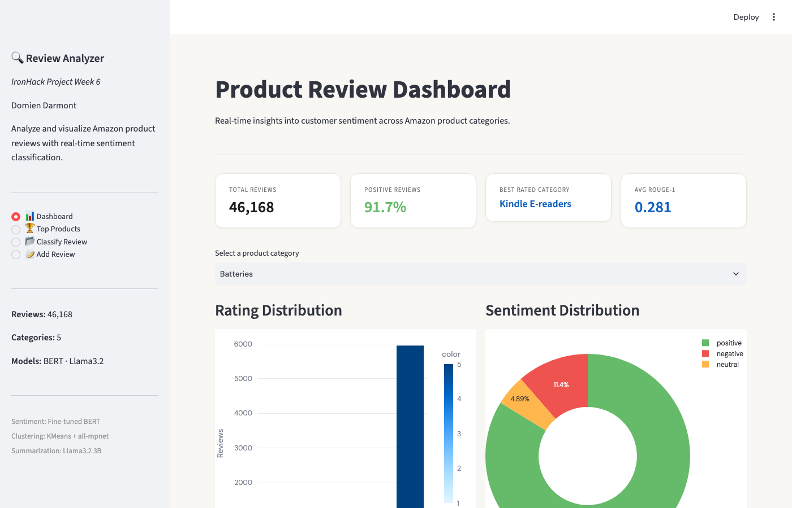
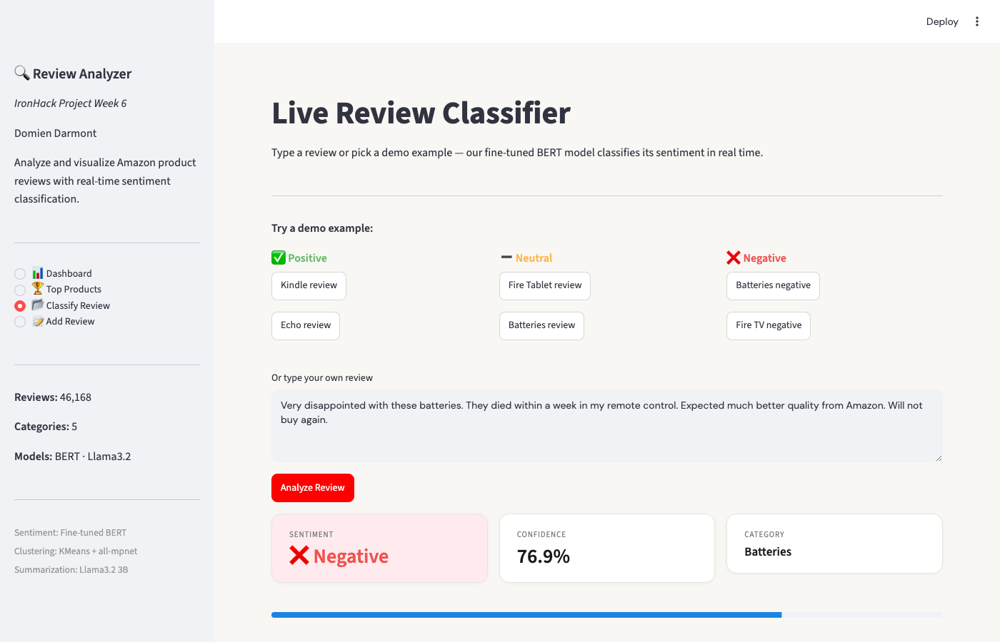

# Amazon Review Analyzer — NLP Pipeline

**Classifies, clusters and summarises 46,000 Amazon product reviews, and turns them into an interactive dashboard and buyer's-guide articles.**


> **In short:** nobody reads 46,000 reviews. This project does it automatically. A fine-tuned BERT model labels each review as positive, neutral or negative. Sentence embeddings group the products into categories. A local LLM (Llama 3.2) writes a "best products" article per category. Everything is explorable in a web app, including a live classifier where you can type your own review.
>
> Ironhack AI Engineering Bootcamp, NLP business case (2026).



---

## What it does

- **Sentiment classification**: a fine-tuned BERT model labels every review (79.4% accuracy on a balanced test set of 900 reviews, 300 per class, up from 77.0% for the base model).
- **Product clustering**: `all-mpnet-base-v2` embeddings and KMeans group the products into 5 categories.
- **Summarisation**: Llama 3.2 (3B, running locally through Ollama) writes a buyer's-guide article per category, evaluated with ROUGE.
- **Web app** with four pages: a dashboard, top products per category, a live classifier, and "add a review" (classified in real time).



## How it works

```
46,169 raw reviews (Kaggle)
        │
        ▼
01 Preprocessing ──► cleaning, deduplication, label mapping (1–5 stars → 3 classes)
        │
        ▼
02 Classification ─► base BERT vs. fine-tuned BERT (class-weighted)
        │
        ▼
03 Clustering ─────► sentence embeddings → UMAP → KMeans (k = 5)
        │
        ▼
04 Summarisation ──► Llama 3.2 via Ollama → articles + ROUGE evaluation
        │
        ▼
Streamlit app
```

## Results

| Component | Model | Result |
|---|---|---|
| Classification | `nlptown/bert-base-multilingual-uncased-sentiment`, fine-tuned | Accuracy 79.4% (macro-F1 0.79), F1 positive 0.82 / negative 0.87 / neutral 0.69 |
| Clustering | `all-mpnet-base-v2` + KMeans (k = 5) | Silhouette 0.343 |
| Summarisation | Llama 3.2 3B (Ollama) | Average ROUGE-1 0.28 (mean of the five categories in `data/processed/rouge_scores.csv`; the ROUGE cells in `04_summarization.ipynb` are not executed in the committed version) |

The classifier is evaluated on a balanced test set (300 reviews per class), so accuracy is not inflated by the large share of positive reviews in the data.

## Tech stack

| Layer | Technology |
|---|---|
| Data | pandas, NumPy |
| NLP models | Hugging Face Transformers, PyTorch, Sentence-Transformers |
| Machine learning | scikit-learn, UMAP |
| LLM | Llama 3.2 via Ollama (runs locally, no API key) |
| Evaluation | ROUGE |
| App & visuals | Streamlit, Plotly |

## Getting started

### Prerequisites
- Python 3.11+
- Optional: [Ollama](https://ollama.com), only needed to regenerate the articles (notebook 04)

### Installation
```bash
git clone https://github.com/DomienDarmontAntwerpen/amazon-review-analyzer.git
cd amazon-review-analyzer
python3 -m venv .venv
source .venv/bin/activate
pip install -r requirements.txt
```

### Configuration
No API keys are needed. The processed data is included in `data/processed/`, so the app runs straight away. The fine-tuned weights are not included in this repo (`data/finetuned_model/` is gitignored because of its size), so out of the box the app's live classifier runs on the base model `nlptown/bert-base-multilingual-uncased-sentiment`, which it downloads automatically on first start. It uses the fine-tuned model only if you first run notebook 02b, which saves it to `data/finetuned_model/bert_sentiment_finetuned`.

### Run
```bash
streamlit run app.py
```
Open http://localhost:8501.

### Reproduce the full pipeline (optional)
1. Download the [Amazon product reviews dataset](https://www.kaggle.com/datasets/datafiniti/consumer-reviews-of-amazon-products) into `data/raw/`.
2. Run the notebooks in order: `01 → 02 → 02b → 03 → 04`.
3. For notebook 04: `ollama pull llama3.2` and `ollama serve`.

## Project structure
```
amazon-review-analyzer/
├── app.py                 # Streamlit app (dashboard, top products, classifier)
├── notebooks/
│   ├── 01_data_preprocessing.ipynb
│   ├── 02_classification_base.ipynb
│   ├── 02b_classification_finetuned.ipynb
│   ├── 03_clustering.ipynb
│   └── 04_summarization.ipynb
├── data/processed/        # Pipeline output used by the app
├── docs/images/           # Screenshots
└── requirements.txt
```

## Status & next steps
Completed project, working end to end. A possible next step is publishing the fine-tuned model on the Hugging Face Hub, so the app no longer needs the fallback model.

## Author
**Domien Darmont** — Operational leader building applied AI systems, Antwerp, Belgium  
GitHub: [@DomienDarmontAntwerpen](https://github.com/DomienDarmontAntwerpen)  
LinkedIn: [Domien Darmont](https://www.linkedin.com/in/domiendarmont/)

A live demo, the project presentation or answers to any questions are available on request.

## License
© 2026 Domien Darmont. All rights reserved.

The source code of this project is published for viewing and evaluation only. No permission is granted to copy, modify, distribute or use it, in whole or in part, without prior written consent from the author.
